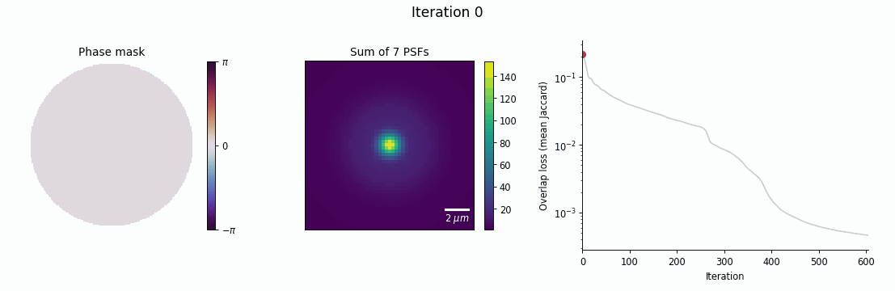

# PSF optimization for minimal overlap of 3D lattice array

Learns a Fourier-plane phase mask that images 7 emitters on the optical axis (Δz = 4.7 µm) as 7 compact, laterally separated spots, so all planes can be read from a single 2D image.



The loss is the mean soft Jaccard overlap between the 7 PSF footprints. Adam optimizes the pupil phase directly, starting from a flat mask.

```bash
python optimize.py --preset lattice_680 --save_every_epoch
python make_figures.py --run results/<run> --gif
```

Requires `torch`, `torchvision`, `numpy`, `matplotlib`, `pillow`.
